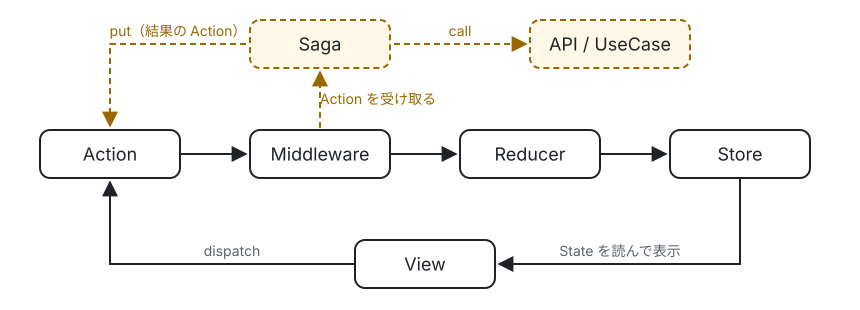

# はじめかた

この文書では、ボタンを押すとカウンターが増え、「読み込み」を押すと非同期で値を取得するアプリを作りながら、swift-redux-saga の基本的な使い方を説明します。Redux や Redux Saga を使ったことがなくても読めるように、考え方から順に説明します。

## 考え方

swift-redux-saga は、アプリの状態を次の 5 つの部品で扱います。

| 部品 | 役割 |
| --- | --- |
| State | アプリの状態を表す値（構造体）。画面に表示するデータはすべてここから読む |
| Action | 「ボタンが押された」「データが届いた」のような出来事を表す値（enum） |
| reducer | 今の State と Action から、次の State を作る関数。副作用（通信など）は持たない |
| Store | State を 1 か所に持ち、Action を受け取って reducer で State を更新する |
| Saga | 通信などの非同期の処理を担当する。Action を待ち、処理をして、結果を Action で返す |

処理の流れは、次のように一方向です。



実線が Redux の通常の流れで、Action は一直線に Reducer まで進みます。点線が Saga（副作用）の流れで、Saga は通常の流れの外側で Action を受け取り、通信などの結果を新しい Action として流れの先頭に戻します。

View は State を読んで表示し、ユーザーの操作を Action として Store に送ります（dispatch）。Action はミドルウェア（Action が reducer に届くまでの間に処理を挟む仕組み）を通って reducer に届きます。Saga も、ミドルウェアから Action を受け取ります。State を書き換えられるのは reducer だけなので、State がいつ、なぜ変わったかを Action の列として追えます。通信のように時間のかかる処理は Saga に任せ、結果も Action として Store に戻します。

## 準備

Xcode でアプリのプロジェクトを作り、File > Add Package Dependencies から次の URL のパッケージを追加します。

```
https://github.com/mitsuharu/swift-redux-saga.git
```

プロダクトは、アプリのターゲットに `ReduxSaga` と `ReduxSwiftUI` を追加します。`ReduxSaga` には Redux 本体（`Redux`）と Saga（`Saga`）が含まれています。

> [!IMPORTANT]
> Xcode 26 で作ったアプリのターゲットは、既定で default MainActor isolation が有効です。State・Action・reducer・Saga はメインアクターの外（Saga の中やテスト）からも使うので、以下の例では型に `nonisolated` を付けています。default MainActor isolation を無効にしたターゲットやパッケージでは、付けなくてもかまいません。

## 1. State・Action・reducer を書く

カウンターの State・Action・reducer を、`Slice` としてまとめます。`Slice` は、1 つの機能の State と Action の型と、reducer をまとめる入れ物です（Redux Toolkit の `createSlice` に当たります）。

```swift
import Redux

nonisolated enum Counter: Slice {
  struct State: Sendable, Equatable {
    var count = 0
    var isLoading = false
    var errorMessage: String?
  }

  enum Action: Sendable, Equatable {
    case incrementTapped
    case fetchTapped
    case fetched(Int)
    case fetchFailed(String)
  }

  static let initialState = State()

  static func reduce(into state: inout State, action: Action) {
    switch action {
    case .incrementTapped:
      state.count += 1
    case .fetchTapped:
      state.isLoading = true
      state.errorMessage = nil
    case .fetched(let value):
      state.isLoading = false
      state.count = value
    case .fetchFailed(let message):
      state.isLoading = false
      state.errorMessage = message
    }
  }
}
```

- State と Action は、メインアクターの外でも受け渡せるよう `Sendable` にします。
- Action の名前は、「何をするか」ではなく「何が起きたか」（`incrementTapped`、`fetched`）で付けると、ログを読んだときに経緯が分かりやすくなります。
- `reduce(into:action:)` は State を `inout` で受け取り、直接書き換えます。通信やファイルの読み書きなどの副作用は書きません。
- `Slice` に準拠すると、`Counter.reducer` で reducer を取り出せます。

## 2. Store を作って表示する

Store は State を持つ入れ物で、アプリに 1 つ作ります。アプリの起動時に作り、`.store(_:)` で View に渡します。

```swift
import Redux
import ReduxSwiftUI
import SwiftUI

@main
struct CounterApp: App {
  @State private var store = Store(initialState: Counter.initialState, reducer: Counter.reducer)

  var body: some Scene {
    WindowGroup {
      CounterView()
        .store(store)
    }
  }
}
```

View では、`@Environment` で Store を取り出し、State を読んで表示します。ボタンが押されたら `dispatch` で Action を送ります。

```swift
struct CounterView: View {
  @Environment(Store<Counter.State, Counter.Action>.self) private var store

  var body: some View {
    VStack(spacing: 16) {
      Text("\(store.count)")
        .font(.largeTitle)
      Button("+1") { store.dispatch(.incrementTapped) }
      Button("読み込み") { store.dispatch(.fetchTapped) }
        .disabled(store.isLoading)
      if let message = store.errorMessage {
        Text(message).foregroundStyle(.red)
      }
    }
  }
}
```

`store.count` のように、State のプロパティを Store から直接読めます。Store は Observation に対応していて、View は読んだプロパティが変わったときだけ再描画されます。この View は `count`・`isLoading`・`errorMessage` を読んでいるので、それ以外のプロパティが変わっても再描画されません。

ここまでで、「+1」を押すとカウンターが増えるアプリになります。「読み込み」を押すと `isLoading` が `true` になりますが、値を取得する処理はまだありません。次に Saga で書きます。

## 3. Saga で非同期の処理を書く

### 通信の処理を用意する

値を取得する処理（ビジネスロジック）は、本ライブラリに依存しない形で書きます。ここでは、取得する関数を持つ構造体にします。

```swift
nonisolated struct CounterRepository: Sendable {
  let load: @Sendable () async throws -> Int
}

extension CounterRepository {
  /// 本番の実装。ここでは通信の代わりに 1 秒待って乱数を返す。
  nonisolated static let live = CounterRepository {
    try await Task.sleep(for: .seconds(1))
    return Int.random(in: 0...100)
  }
}
```

このように、Saga から呼ぶ処理を本ライブラリに依存させないでおくと、テストでは別の実装に差し替えられます。後で状態管理の方法を変えることになっても、この部分は書き直さずに済みます。

### Saga を書く

Saga は、Action を待ち、処理をして、結果を Action で返す async 関数です。`ctx`（`SagaContext`）の関数を `await` で呼んで、Action を待ったり（`take`）、関数を呼んだり（`call`）、Action を発行したり（`put`）します。これらの関数を Effect と呼びます。

```swift
import Saga

nonisolated struct CounterSagas: Sendable {
  let repository: CounterRepository

  var root: Saga<Counter.State, Counter.Action> {
    Saga("counter") { ctx in
      // fetchTapped が届くたびにワーカー（後ろのクロージャ）を動かす。
      // 前のワーカーが動いていればキャンセルする（連打しても最後の 1 回だけが残る）。
      ctx.takeLatest(.action(.fetchTapped)) { ctx, _ in
        do {
          let value = try await ctx.call(repository.load)
          await ctx.put(.fetched(value))
        } catch is CancellationError {
          // takeLatest がキャンセルした。何もしない。
        } catch {
          await ctx.put(.fetchFailed(error.localizedDescription))
        }
      }
    }
  }
}
```

- `Saga("counter")` の文字列は、デバッグ用の名前です。エラーが起きたときに、どの Saga で起きたかの表示に使われます。
- `.action(.fetchTapped)` は、待つ Action を表すパターンです。Action が等しいかで判定します。関連値を持つ case から値を取り出すパターン（`.case`）もあります。
- `takeLatest` は、Action が届くたびにワーカーを動かすヘルパーです。ほかに、届いたものをすべて処理する `takeEvery`、動いている間は次を無視する `takeLeading` があります。
- 失敗し得る処理は、ワーカーの中で `catch` して Action で返します。`catch` しないエラーは Saga 全体を止めてしまいます。

依存（`repository`）は、Saga を作るときに渡します。シングルトンにしないので、テストでは別の実装を渡せます。

### Store に Saga をつなぐ

Saga は、`SagaMiddleware` を通して Store につなぎます。ミドルウェアは、dispatch された Action が reducer に届くまでの間に処理を挟む仕組みで、`SagaMiddleware` は届いた Action を Saga に渡します。

Store を作る処理を関数にまとめ、Store を作った後で Saga を起動（`run`）します。

```swift
import Redux
import ReduxSaga

@MainActor
func makeStore() -> Store<Counter.State, Counter.Action> {
  let sagaMiddleware = SagaMiddleware<Counter.State, Counter.Action>()
  let store = Store(
    initialState: Counter.initialState,
    reducer: Counter.reducer,
    middleware: [sagaMiddleware]
  )
  sagaMiddleware.run(CounterSagas(repository: .live).root)
  return store
}
```

アプリでは、この関数で Store を作ります。

```swift
@main
struct CounterApp: App {
  @State private var store = makeStore()

  var body: some Scene {
    WindowGroup {
      CounterView()
        .store(store)
    }
  }
}
```

これで、「読み込み」を押すと 1 秒後にカウンターが取得した値に変わります。読み込み中にもう一度押すと、前の読み込みはキャンセルされ、最後の 1 回の結果だけが反映されます。

## 4. テストを書く

テスト用のターゲットに `ReduxTesting` を追加します。`TestStore` は、Action を送り、State の変化と Saga が発行した Action を順に確かめるための Store です。

```swift
import ReduxTesting
import Testing

@testable import CounterApp

@MainActor
@Test func fetchingShowsTheLoadedValue() async throws {
  let store = TestStore(
    initialState: Counter.initialState,
    reducer: Counter.reducer,
    saga: CounterSagas(repository: CounterRepository { 42 }).root
  )

  // fetchTapped を送ると、読み込み中になる。
  try await store.send(.fetchTapped) {
    $0.isLoading = true
  }
  // Saga が fetched(42) を発行し、カウンターが 42 になる。
  try store.receive(.fetched(42)) {
    $0.isLoading = false
    $0.count = 42
  }
  try await store.finish()
}

struct LoadError: Error {}

@MainActor
@Test func aFailedFetchShowsAnError() async throws {
  let store = TestStore(
    initialState: Counter.initialState,
    reducer: Counter.reducer,
    saga: CounterSagas(repository: CounterRepository { throw LoadError() }).root
  )

  try await store.send(.fetchTapped) {
    $0.isLoading = true
  }
  try store.receive(.fetchFailed(LoadError().localizedDescription)) {
    $0.isLoading = false
    $0.errorMessage = LoadError().localizedDescription
  }
  try await store.finish()
}
```

- `send` と `receive` の後ろのクロージャには、期待する State の変化を書きます。直前の State を受け取り、Action を適用した後の State になるように書き換えてください。実際の State と違えば、テストは失敗します。
- `send` は、Action を送った後、すべての Saga が Effect（次の Action を待つ `take` や、`delay` など）で止まるまで待ちます。実際の時間ではなく Saga の状態で待ち合わせるので、テストが実行環境の速さに左右されません。
- 通信の代わりに、すぐ値を返す `CounterRepository { 42 }` を渡しています。依存を Saga の作成時に渡しているので、このように差し替えられます。
- `finish()` は、確かめていない Action が残っていないことを確かめて、Saga を止めます。

## 次に読むもの

- [README の「使い方」](../README.md#使い方): ここで扱わなかった機能（マクロ、SwiftUI のフック、UIKit、MVVM との併用など）
- [Saga の Effect](saga-effects.md): `take` / `put` / `call` / `fork` など、Saga で使える Effect の一覧と使い方
- [機能を組み合わせる](composition.md): ログインと ToDo のように、複数の機能を 1 つのアプリにまとめる方法
- [ミドルウェア](middleware.md) / [State の永続化](persistence.md)
- [サンプル](../Examples): ログインと ToDo の 2 つの機能を持つアプリ（SwiftUI / UIKit）
